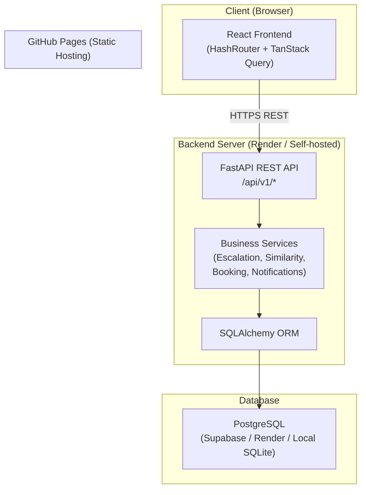

<div align="center">

# 🎓 BridgeX

### Connecting Students. Bridging Doubts. Empowering Faculty.

[](https://github.com/aryanjaat2323/bridgex-academic-platform/actions/workflows/ci-backend.yml)
[](https://github.com/aryanjaat2323/bridgex-academic-platform/actions/workflows/ci-frontend.yml)
[](https://github.com/aryanjaat2323/bridgex-academic-platform/actions/workflows/deploy-pages.yml)
[](LICENSE)

**[🌐 Live Demo](https://aryanjaat2323.github.io/bridgex-academic-platform/) · [📖 API Docs](http://localhost:8000/docs) · [🐛 Report Bug](https://github.com/aryanjaat2323/bridgex-academic-platform/issues) · [✨ Request Feature](https://github.com/aryanjaat2323/bridgex-academic-platform/issues)**


</div>

---

## 📋 Overview

Academic communication in universities is often fragmented — students post doubts on WhatsApp, faculty respond sporadically, and institutional knowledge is lost permanently.

**BridgeX** solves this with a centralized academic doubt management platform that:

- Gives students a structured channel to submit, track, and search academic doubts
- Gives faculty a prioritized queue with filters, duplicate merging, and a verified answers repository
- Gives Class Representatives section-wide analytics and the ability to forward doubts
- Gives administrators KPI dashboards, SLA monitoring, and full user management

---

## ✨ Key Features

### 🎓 Student Portal
- **Structured Doubt Submission** — Subject, topic, urgency, description, context notes, and attachments
- **Real-time Duplicate Detection** — Tokenized lexical matching suggests existing resolved questions as you type
- **Doubt Lifecycle Tracking** — Visual status timeline: Pending → Seen → Queued → Answered → Resolved
- **Solved Repository** — Searchable knowledge base of faculty-verified answers with ratings and upvotes
- **Office Hour Booking** — Browse faculty availability and book concurrency-safe consultation slots
- **Notifications** — In-app alerts for status changes and responses

### 👩‍🏫 Faculty Portal
- **Prioritized Doubt Queue** — Filter by urgency, status, subject, escalation, and search
- **Status Management** — Mark doubts as Seen, Queued, Answered, or Resolved
- **Verified Answer Publishing** — 1-click publish faculty answers to the Solved Repository
- **Duplicate Merging** — Merge duplicate queries while preserving each student's history
- **Office Hour Scheduling** — Set recurring weekly availability with configurable slot durations
- **Analytics** — Response time metrics, subject breakdown, and resolution rate charts

### 📋 Class Representative (CR) Portal
- **Section-Wide Analytics** — Monitor all doubts in your section
- **Recurring Topic Identification** — Spot trending subjects and exam-period spikes
- **Doubt Forwarding** — Endorse and route student doubts directly to designated faculty with CR notes
- **Course-wise Summaries** — Aggregated stats per subject

### 🏛️ Admin / HOD Portal
- **Department KPIs** — Total doubts, response rates, resolution rates, escalation counts
- **Faculty Leaderboards** — Ranked by response time and resolution rate
- **48-Hour SLA Monitoring** — Auto-escalation engine, escalated doubt tracking, admin alerts
- **User Management** — View all users, change roles, activate/deactivate accounts
- **Academic Mappings** — Assign faculty to subjects and sections

---

## 🖼️ Screenshots

> Screenshots of the running application are located in [`docs/screenshots/`](docs/screenshots/).
> To generate them, run the application locally and use the demo accounts below.

| Portal | Description |
|---|---|
| Landing Page | Marketing page with feature overview |
| Student Dashboard | Overview stats, recent doubts, quick actions |
| Submit Doubt | Multi-step form with live duplicate suggestions |
| Faculty Queue | Prioritized doubt queue with filters |
| Admin Dashboard | Department KPIs and escalation monitoring |

---

## 🛠️ Technology Stack

### Frontend
| Technology | Purpose |
|---|---|
| React 18 | UI framework |
| TypeScript 5.x | Static typing |
| Vite 5.x | Build tool and dev server |
| Tailwind CSS 3 | Utility-first styling |
| React Router v6 | Client-side routing (HashRouter) |
| TanStack Query v5 | Server state management |
| React Hook Form + Zod | Form handling and validation |
| Recharts | Analytics charts |
| Lucide React | Icon library |
| Axios | HTTP client |

### Backend
| Technology | Purpose |
|---|---|
| Python 3.11+ | Runtime |
| FastAPI 0.110+ | REST API framework |
| SQLAlchemy 2.0 | ORM and database abstraction |
| Pydantic v2 | Data validation and serialization |
| Python-JOSE | JWT authentication |
| bcrypt | Password hashing |
| Uvicorn | ASGI server |
| Pytest + HTTPX | Automated testing |

### Database & Infrastructure
| Technology | Purpose |
|---|---|
| SQLite | Local development (zero setup) |
| PostgreSQL | Production database |
| Supabase | PostgreSQL hosting + auth-ready |
| GitHub Pages | Frontend hosting |
| Render | Backend hosting (recommended) |

---

## 🏗️ Architecture



---

## 🚀 Local Quickstart

### Prerequisites

- **Node.js** ≥ 18 and **npm** ≥ 9
- **Python** ≥ 3.11
- **Git**

### 1. Clone the Repository

```bash
git clone https://github.com/aryanjaat2323/bridgex-academic-platform.git
cd bridgex-academic-platform
```

### 2. Backend Setup

```bash
cd backend

# Create and activate virtual environment
python -m venv venv

# macOS / Linux
source venv/bin/activate

# Windows (PowerShell)
venv\Scripts\Activate.ps1

# Install dependencies
pip install -r requirements.txt

# Configure environment
cp .env.example .env
# Edit .env and set SECRET_KEY to a strong random value

# Seed the database with demo accounts
python -m app.seed.seed_data

# Start the development server
uvicorn app.main:app --reload --port 8000
```

Backend runs at: **http://localhost:8000**
Interactive API docs: **http://localhost:8000/docs**

### 3. Frontend Setup

```bash
cd frontend

# Install dependencies
npm install

# Configure environment
cp .env.example .env.local
# For local dev, VITE_API_URL can remain empty (proxy handles it)

# Start the development server
npm run dev -- --port 3000
```

Frontend runs at: **http://localhost:3000**

---

## 🔐 Environment Variables

### Backend (`backend/.env`)

| Variable | Required | Description |
|---|---|---|
| `SECRET_KEY` | ✅ Yes | JWT signing secret — generate with `python -c "import secrets; print(secrets.token_hex(32))"` |
| `DATABASE_URL` | ⚠️ Prod only | PostgreSQL connection string. Defaults to SQLite locally. |
| `ESCALATION_HOURS_THRESHOLD` | No | Hours before auto-escalation (default: `48`) |
| `UPLOAD_DIR` | No | File upload directory (default: `./uploads`) |

### Frontend (`frontend/.env.local`)

| Variable | Required | Description |
|---|---|---|
| `VITE_API_URL` | ⚠️ Prod only | Full URL of deployed backend. Leave empty for local dev. |

See [`backend/.env.example`](backend/.env.example) and [`frontend/.env.example`](frontend/.env.example) for templates.

---

## 👥 Demo Accounts

The database is pre-seeded with realistic institutional accounts. All use password **`password123`**.

Use the **1-Click Persona Switcher** on the login page for instant access.

| Role | Name | Email |
|---|---|---|
| 🎓 Student | Aarav Sharma | `student@bridgex.edu` |
| 👩‍🏫 Faculty | Dr. Priya Raman | `faculty@bridgex.edu` |
| 👩‍🏫 Faculty | Prof. Rajesh Nair | `faculty2@bridgex.edu` |
| 📋 Class Rep | Tanya Verma | `cr@bridgex.edu` |
| 🏛️ Admin / HOD | Dr. K. Venkat | `admin@bridgex.edu` |

> **Note:** The live GitHub Pages demo requires a running backend. For a fully functional demo, run the backend locally and point `VITE_API_URL` accordingly.

---

## 🧪 Running Tests

### Backend

```bash
cd backend
source venv/bin/activate   # Windows: venv\Scripts\Activate.ps1
pytest -v
```

Test coverage:
- `test_doubts.py` — Doubt creation, faculty routing, status transitions, audit timeline
- `test_duplicates.py` — Lexical similarity and academic stemming
- `test_escalation.py` — 48-hour SLA breach detection and admin alerts
- `test_office_hours.py` — Concurrency-safe booking and double-booking rejection

### Frontend

```bash
cd frontend
npm run build   # TypeScript type-check + production build
```

---

## 🌐 API Documentation

When the backend is running locally:

- **Interactive (Swagger UI)**: http://localhost:8000/docs
- **ReDoc**: http://localhost:8000/redoc
- **Health Check**: http://localhost:8000/api/health

### API Module Summary

| Prefix | Module | Description |
|---|---|---|
| `/api/v1/auth` | Authentication | Login, registration, current user |
| `/api/v1/academic` | Academic | Departments, courses, subjects, faculty mappings |
| `/api/v1/doubts` | Doubts | CRUD, status transitions, responses, escalation |
| `/api/v1/duplicates` | Duplicates | Similarity detection and merge operations |
| `/api/v1/repository` | Repository | Solved knowledge base, upvotes, ratings |
| `/api/v1/office-hours` | Office Hours | Slot management and booking |
| `/api/v1/notifications` | Notifications | In-app notification management |
| `/api/v1/analytics` | Analytics | KPIs, leaderboards, usage stats |
| `/api/v1/admin` | Admin | User and role management |

---

## 🚢 Deployment

### Frontend → GitHub Pages

Automatically deployed on every push to `main` via GitHub Actions.

See [`docs/deployment/github-pages-frontend.md`](docs/deployment/github-pages-frontend.md).

**Live URL:** https://aryanjaat2323.github.io/bridgex-academic-platform/

### Backend → Render

See [`docs/deployment/render-backend.md`](docs/deployment/render-backend.md) for the step-by-step guide.

> **Important:** GitHub Pages hosts only the static frontend. Backend features require a separately deployed FastAPI server.

---

## 🤝 Contributing

Contributions are welcome! Please read [CONTRIBUTING.md](CONTRIBUTING.md) before submitting a pull request.

1. Fork the repository
2. Create a feature branch (`git checkout -b feat/your-feature`)
3. Commit your changes (`git commit -m 'feat: add your feature'`)
4. Push to the branch (`git push origin feat/your-feature`)
5. Open a Pull Request

---

## 📄 License

This project is licensed under the **MIT License** — see the [LICENSE](LICENSE) file for details.

---

<div align="center">

**BridgeX** — Built with ❤️ for better academic communication.

[⬆ Back to top](#-bridgex)

</div>
